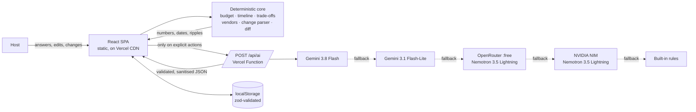

# Lehar: plan the celebration, handle the ripples

**An open-source GenAI planning assistant for weddings, birthdays and community events in India.** It
gives you a budget that adds up to the rupee, a timeline in the right order, vendor checklists and ideas
that fit your guests. When something changes, Lehar shows how it ripples through everything, and **you**
decide.

_Lehar (लहर) is Hindi for "wave" or "ripple": one change in a plan sends a wave through the budget,
timeline and vendors._

[](https://github.com/arsinghin/lehar/actions/workflows/ci.yml)
[](LICENSE)

Live app: `https://<your-vercel-project>.vercel.app` · Made by **AR Singh**
([@arsinghin](https://github.com/arsinghin))

---

## 1. Who it is for

**A first-time family host in India.** This is someone organising one important celebration with a fixed
rupee budget, a date that matters, a lot of advice from relatives, and no planning system. Three event
types are supported: **weddings, milestone and kids' birthdays, and community or society events** (with
volunteers, permissions and safety).

| Question                         | Answer                                                                                                                                                                                                                                  |
| -------------------------------- | --------------------------------------------------------------------------------------------------------------------------------------------------------------------------------------------------------------------------------------- |
| What is the most stressful part? | **Connected decisions.** Guests, budget, venue and date all affect each other, so one change breaks the plan.                                                                                                                           |
| How does GenAI make it better?   | It turns plain-language changes into structured plan edits, personalises ideas within real constraints, and drafts sharp vendor questions. **The AI suggests and the code decides**: every rupee and every date comes from tested code. |

## 2. Try it in 60 seconds

1. Open the app and choose **"A wedding, 4 months away"**: ₹8,00,000 and 200 guests.
2. Click **Try a sample change**. It is pre-filled with _"We now have 50 more guests, our budget is down
   by 10%, and the event is happening 2 weeks earlier."_
3. **Preview the ripple.** You see the budget move from tight to over, the line-by-line deltas, the
   timeline compressing, _both caterer quotes flagged for re-quoting at 250 guests_, and what is kept
   (completed tasks and quotes). Nothing is rebuilt from scratch.
4. **Apply.** Open **Budget**: the trade-off assistant ranks the options by what matters to this family.
   Catering is protected, so it is never touched. Pick some options or **Select Lehar's suggestion**,
   then apply.
5. Change your mind? Use **Undo**, or restore any earlier version from **History**.

Other demos: _Same wedding, 20% over budget_ · _A 6th birthday party_ · _A society Diwali mela_.

## 3. Features

| Need                                                                       | What Lehar does                                                                                                                                                                                                                                                                                                                                                                                                                           |
| -------------------------------------------------------------------------- | ----------------------------------------------------------------------------------------------------------------------------------------------------------------------------------------------------------------------------------------------------------------------------------------------------------------------------------------------------------------------------------------------------------------------------------------- |
| Start with practical questions: occasion, budget, guests, date, must-haves | A 5-step intake: occasion, date and city → guests, budget ("8 lakh" works) and style → priorities 1–5 with **Protect** toggles → ages, diets, accessibility, culture, must-haves → review with a first estimate.                                                                                                                                                                                                                          |
| Budget by category, compare scenarios, **see consequences**                | A category budget built from documented assumptions, with guest-scaled and fixed lines. Every edit (style per category, guests, buffer, rates) shows a **ripple message**, e.g. "Decoration style → Premium: +₹69,300 on the total. Now ₹8,66,800 (over budget by ₹66,800)".                                                                                                                                                              |
| Prices you can trust                                                       | Every line is labelled **Estimate (assumption)**, **Your rate** or **Quote · vendor**. The assumptions are visible and editable. The AI is forbidden from emitting money, and its output is sanitised of amounts.                                                                                                                                                                                                                         |
| Timeline: priority, deadlines, **dependencies**, updates when tasks slip   | A task graph per event type (e.g. date → venue → caterer → menu), back-scheduled from your date. It compresses proportionally when time is short and gives a **Do next** list. **Delaying a task ripples to every dependent task** and says how many moved.                                                                                                                                                                               |
| Over budget? Understand the trade-offs instead of cutting blindly          | The **trade-off assistant** lists concrete options (simpler package, skip a low-priority extra, trim guests, shrink the buffer). Each shows what it saves and which of _your_ priorities it touches, ranked by savings per unit of pain. Protected areas and a locked guest count are never touched, and nothing is pre-selected.                                                                                                         |
| Vendors: define needs, ask the right questions, compare quotes             | A requirement sheet per vendor (plates with a 5% buffer, diets, accessibility, capacity). There is a question checklist, plus **AI questions tailored to your event**. Enter quotes and compare like for like: per guest, against your estimate, "covers 180 of 200 guests", "Clarify: GST", and the lowest _complete_ quote. A **Google Maps** search link is provided and clearly marked _unverified_. Lehar never claims availability. |
| Personalised ideas, refined through conversation                           | Three concepts shaped by ages, diets, accessibility, culture, must-haves and how the budget feels. Refine with **Cheaper · Kid-friendly · Elder-friendly · More traditional · Eco-friendly**, or in your own words.                                                                                                                                                                                                                       |
| Plans change (+50 guests, less budget, 2 weeks earlier)                    | **"Something changed?"** → parse → **diff preview** → apply or cancel → **undo and version history**. Completed tasks, quotes and ideas are kept.                                                                                                                                                                                                                                                                                         |
| Ask, don't assume                                                          | Vague input gets a question back. For example, "our budget decreased a bit" → _"By how much did the budget change?"_.                                                                                                                                                                                                                                                                                                                     |
| Stay in control                                                            | Nothing is auto-applied. Every AI output carries a source badge. "What Lehar sends to the AI" shows the exact payload. There is no marketplace, payments or login (see §10).                                                                                                                                                                                                                                                              |

## 4. How it works: "the AI suggests, the code decides"



- **The deterministic core** (`src/core`, pure TypeScript) owns everything that must be correct: budget
  lines that always sum exactly, per-guest maths, warning thresholds, a dependency-ordered and
  compressible schedule, delay propagation, trade-off ranking, quote comparison, the change parser and
  the plan diff. It runs in the browser, so the plan is instant and works offline.
- **GenAI** is used only where it adds value (see §5). Its output is treated as untrusted: it is
  schema-constrained, re-validated with zod on the server _and_ in the browser, sanitised (no prices, URLs,
  phone numbers or emails) and labelled with its source.
- **A change is data, not a rebuild.** A change becomes a `ProfilePatch`. `diffPlans(before, after)`
  computes the ripples before you apply it, and the store keeps an undo/redo history of every committed
  version.

## 5. Where GenAI is used, and where it deliberately is not

| Used for                                                       | Why AI                                  | Guardrails                                                                                                                                                                                                                                                        |
| -------------------------------------------------------------- | --------------------------------------- | ----------------------------------------------------------------------------------------------------------------------------------------------------------------------------------------------------------------------------------------------------------------- |
| **Personalised ideas** and refinements                         | Creative, context-heavy and subjective  | Schema output; told never to state prices, vendors or availability; amounts and URLs stripped; source badge                                                                                                                                                       |
| **Understanding free-text changes** that the rules can't parse | Natural language is varied              | Rules run first (they are instant and exact; typical changes never need the AI). AI output is mapped into the same validated `Change` type and range-checked, the preview is labelled "Interpreted by AI, please check", and nothing applies without confirmation |
| **Vendor questions tailored to the event**                     | Domain knowledge applied to your guests | De-duplicated, sanitised; the generic checklist always remains                                                                                                                                                                                                    |
| _Not used:_ budgets, dates, trade-offs, quote maths, schedules | These must be exact and explainable     | Pure functions with unit and property-based tests                                                                                                                                                                                                                 |

**Models (free tier only, chosen to balance latency, accuracy and cost):**

1. `gemini-3.8-flash` via the official **`@google/genai`** SDK, with `thinkingLevel: LOW` and a JSON-schema response.
2. `gemini-3.1-flash-lite`: the fastest model, on the same free key.
3. OpenRouter `nvidia/nemotron-3.5-lightning:free`, with reasoning off and the schema repeated in the
   prompt (this model does not support `response_format`).
4. NVIDIA NIM `nvidia/nemotron-3.5-lightning-30b-a3b` on a free build.nvidia.com key, with thinking off
   (`chat_template_kwargs.enable_thinking: false`).
5. **Built-in rules**, so the app never breaks and the fallback is labelled "Built-in suggestion".

Cost safety is enforced in code (`server/config.ts`). Only Gemini Flash, Flash-Lite and Gemma ids, and
OpenRouter ids ending in `:free`, are accepted (NVIDIA ids must be plain catalog ids, used with a free
Developer Program key); anything else is dropped at startup and covered by tests.
Other protections: per-attempt timeouts (12 s for Gemini, 22 s for free endpoints), an overall 50 s
deadline, a circuit breaker after 429/5xx, an
LRU cache and per-IP rate limits, all to protect the free quotas.

**Google services used:** Gemini API (`@google/genai`), Google Calendar (per-task "add to Google Calendar"
links and a full `.ics` export) and Google Maps (vendor search links). The Calendar and Maps integrations
are keyless links, so they add no secrets.

## 6. Quality at a glance

| Area              | Details                                                                                                                                                                                                                                                                                                                                                                                         |
| ----------------- | ----------------------------------------------------------------------------------------------------------------------------------------------------------------------------------------------------------------------------------------------------------------------------------------------------------------------------------------------------------------------------------------------- |
| **Code quality**  | Strict TypeScript (`noUncheckedIndexedAccess`, a separate NodeNext config for the server) · ESLint `strictTypeChecked` + `jsx-a11y/strict` + `react-hooks` with **0 warnings** · Prettier · zod schemas as the single source of truth for types · pure core with no framework imports (lint-enforced) · small modules · ADRs in [`docs/DECISIONS.md`](docs/DECISIONS.md)                        |
| **Security**      | [`SECURITY.md`](SECURITY.md): server-only keys, strict CSP with no `unsafe-inline`, HSTS, COOP/CORP, same-origin API, 8 KB body cap, zod `strictObject` validation, rate limiting, prompt-injection screen, `<event_data>` delimiting with `<` escaped, output sanitiser, no `dangerouslySetInnerHTML`, validated localStorage and imports, PII minimisation, secret scan and `npm audit` in CI |
| **Performance**   | About 93 kB gzip first load and 120 kB total JS (CI-enforced budget) · lazy-loaded screens · system fonts, inline SVG, no images · immutable asset caching · AI called only on explicit actions, with caching and de-duplication · deterministic change parsing with zero AI calls for typical changes                                                                                          |
| **Testing**       | [`docs/TESTING.md`](docs/TESTING.md): unit and integration tests (Vitest, Testing Library, fast-check property tests, axe) + **5 Playwright journeys × 2 devices**. Coverage gates: core ≥ 95%, server ≥ 95%, overall ≥ 90%                                                                                                                                                                     |
| **Accessibility** | [`docs/ACCESSIBILITY.md`](docs/ACCESSIBILITY.md): WCAG 2.2 AA, with axe at 0 violations on every screen in both themes · colour contrast unit-tested from the real tokens · keyboard-only e2e · reflow at 320 px tested · focus management, live regions, error summary, labelled scroll regions, reduced motion                                                                                |

## 7. Assumptions

- **Prices are planning assumptions**, not quotes: round, mid-range figures for an Indian metro or
  tier-2 city in 2026 at the "standard" tier (`src/core/constants/rates.ts`, every one documented). Simple
  is about 60% and premium about 170% of standard. A 10% buffer is the default. Hosts can overwrite any rate.
- Ideal lead times come from common Indian practice (e.g. book the wedding venue about 100 days ahead).
  With less time, deadlines are compressed proportionally and flagged.
- Currency is INR with Indian digit grouping. The UI is in English (Hindi is a planned extension).
- One host per plan, stored in their own browser. There is no account, sync or multi-user editing.
- Lehar does **not** search, rate, book or verify real vendors, and does not check availability or prices.

## 8. Run it locally

```bash
npm ci
npm run dev          # SPA only. AI features fall back to built-in suggestions.
npx vercel dev       # SPA + /api functions (needs .env.local, see .env.example)
npm run verify       # typecheck, lint, format, tests + coverage, secret scan, build, size budget
npm run test:e2e     # Playwright (run `npx playwright install chromium` once,
                     # or set PW_CHROMIUM_PATH to an installed Chromium)
```

### Deploy to Vercel (free Hobby plan)

1. Push this repository to GitHub.
2. In Vercel, use **Add New → Project → Import** on the repo. The framework preset is **Vite**. The build
   command, output directory, headers and function settings come from `vercel.json`.
3. **Settings → Environment Variables** (Production and Preview):
   - `GEMINI_API_KEY` (recommended): from [Google AI Studio](https://aistudio.google.com/), in a project
     with **no billing account**, so it physically cannot be charged. Gemini is the fastest and most
     reliable option.
   - `OPENROUTER_API_KEY` (optional fallback, or the only provider). Keep the OpenRouter balance at $0.
     In OpenRouter's [privacy settings](https://openrouter.ai/settings/privacy), allow the free endpoints;
     otherwise every free model answers "No endpoints found matching your data policy".
   - `NVIDIA_API_KEY` (optional fallback after OpenRouter): a free NVIDIA Developer Program key from
     [build.nvidia.com](https://build.nvidia.com/). Use only models marked "Free Endpoint".
   - Optional: `GEMINI_MODELS`, `OPENROUTER_MODELS` and `NVIDIA_MODELS` (comma-separated, free-tier ids
     only), and `OPENROUTER_REASONING=low` if you pick an OpenRouter model that requires reasoning.
4. **Redeploy** after changing environment variables. Then open `/api/health`, which reports which
   providers are configured (as booleans only).

### Troubleshooting: "AI suggestions are unavailable right now"

This message means every configured model failed, so Lehar used its built-in rules. Open the Vercel
project → **Logs**, filter for `provider_failed`, and read the `outcome` field:

| `outcome`                                                             | Fix                                                                                                        |
| --------------------------------------------------------------------- | ---------------------------------------------------------------------------------------------------------- |
| `Provider timed out`                                                  | The free endpoint was slow or busy; try again, add `NVIDIA_API_KEY` as a fallback, or add `GEMINI_API_KEY` |
| `OpenRouter 404: privacy settings block free models`                  | Allow free endpoints in OpenRouter's privacy settings                                                      |
| `OpenRouter 401: invalid OPENROUTER_API_KEY`                          | Re-copy the key into Vercel, then redeploy                                                                 |
| `OpenRouter 429: free-model rate limit`                               | Free models allow only a few dozen requests a day on a $0 account; add another provider                    |
| `OpenRouter 400: model needs reasoning, set OPENROUTER_REASONING=low` | Set that variable, or pick a model whose reasoning can be switched off                                     |
| `NVIDIA 401: invalid NVIDIA_API_KEY`                                  | Re-copy the `nvapi-…` key into Vercel, then redeploy                                                       |
| `NVIDIA 404: model not found, check NVIDIA_MODELS`                    | Use an id exactly as shown on build.nvidia.com                                                             |
| `NVIDIA 429: free endpoint rate limit`                                | Wait a minute; free endpoints are rate limited per key                                                     |
| `… ran out of tokens before answering`                                | The model reasoned too long; keep reasoning off or choose a non-reasoning model                            |
| `Model output failed schema validation`                               | The model ignored the schema; try another free model                                                       |

Logs contain only operational fields (provider, status, duration, outcome), never what people typed.

## 9. Project structure

```
api/                 Vercel Functions: ai.ts (POST), health.ts (GET)
server/              AI gateway: handler, provider chain, prompts, tasks, security, cache, config
src/core/            Pure domain engines + zod schemas (shared by the browser and the server)
src/features/        Screens: home, intake, overview, budget, timeline, vendors, ideas, changes, history
src/components/      Accessible primitives: Field, ChoiceGroup, Dialog, Tabs, Notice, TableScroll…
src/state/           Store (undo/redo), persistence, React context
tests/               Test setup, fixtures, Playwright journeys
docs/                Architecture, prompts, testing, accessibility, decisions
```

## 10. Scope, limitations and roadmap

Deliberately out of scope, to keep the tool small and focused: a vendor marketplace, payments, login,
guest RSVP and invitations. Limitations: rate limiting and caching are per serverless instance (a shared
store such as Vercel KV would be the next step), and free-tier model availability can change, which is
why every model id is configurable and the rules fallback exists. Roadmap: a Hindi UI, shared plans for
families, and an installable offline PWA.

## 11. Contributing

Issues and pull requests are welcome. Please run `npm run verify` before opening a pull request, keep
every number and date in the deterministic core, and add a test with each change. Prompt changes should
bump the version in `server/ai/prompts.ts` and add a row to [`docs/PROMPTS.md`](docs/PROMPTS.md).
Security issues: see [`SECURITY.md`](SECURITY.md).

## 12. License and credit

Copyright 2026 **AR Singh** ([@arsinghin](https://github.com/arsinghin)). Licensed under the
[Apache License 2.0](LICENSE).

You may use, modify and distribute Lehar, **including commercially**, as long as you keep the
[`LICENSE`](LICENSE) and [`NOTICE`](NOTICE) files with your copy and show the attribution from `NOTICE`
where your product lists credits or third-party notices. A credit line such as
_"Based on Lehar by AR Singh (@arsinghin)"_ with a link to this repository is appreciated.
