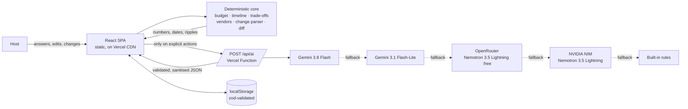

<div align="center">


# Lehar

**Plan the celebration. Handle the ripples.**

An open-source, AI-assisted planner for weddings, birthdays and community events in India. It gives
you budgets that add up to the rupee, dependency-aware timelines, vendor checklists and personalised
ideas, and when plans change it shows every ripple before anything is applied.

[](https://github.com/arsinghin/lehar/actions/workflows/ci.yml)
[](LICENSE)


<sub><i>Lehar (लहर) is Hindi for "wave" or "ripple": one change in a plan sends a wave through the
budget, timeline and vendors.</i></sub>

</div>

---

## Contents

- [Overview](#overview)
- [Features](#features)
- [Quick tour](#quick-tour)
- [Architecture](#architecture)
- [AI integration](#ai-integration)
- [Tech stack](#tech-stack)
- [Getting started](#getting-started)
- [Configuration](#configuration)
- [Deployment](#deployment)
- [Troubleshooting](#troubleshooting)
- [Quality and engineering](#quality-and-engineering)
- [Project structure](#project-structure)
- [Assumptions and limitations](#assumptions-and-limitations)
- [Roadmap](#roadmap)
- [Contributing](#contributing)
- [License and attribution](#license-and-attribution)

## Overview

Planning a family celebration is a web of connected decisions: guests drive catering, catering drives
budget, and the date drives every booking deadline. When one of them changes, the whole plan breaks,
and most tools either ignore the change or rebuild everything from scratch.

Lehar is built for **first-time hosts** organising one important event with a fixed budget, a date that
matters and no planning system. It follows one principle: **the AI suggests, the code decides.**

- **Every number and date comes from deterministic, tested code.** Budgets, schedules, trade-offs and
  quote comparisons are pure TypeScript functions that run in the browser and work offline.
- **Generative AI handles language and personalisation only.** It turns free-text changes into
  structured edits, tailors ideas to the guests, and drafts vendor questions. Its output is
  schema-validated, sanitised and always labelled with its source.
- **The host stays in control.** Every change is previewed as a diff, applied only on confirmation, and
  can be undone or restored from version history.

Supported events: **weddings**, **milestone and kids' birthdays**, and **community or society events**
(with volunteers, permissions and safety tasks).

## Features

**Guided intake**

- Five short steps: occasion, date and city → guests, budget ("8 lakh" works) and style → priorities
  with **Protect** toggles → ages, diets, accessibility, culture, must-haves → review with a first estimate.

**Budget you can trust**

- Category budget from documented assumptions, with guest-scaled and fixed lines that always sum exactly.
- Every line is labelled **Estimate (assumption)**, **Your rate** or **Quote · vendor**; every
  assumption is visible and editable.
- Each edit reports its ripple, e.g. _"Decoration style → Premium: +₹69,300 on the total. Now
  ₹8,66,800 (over budget by ₹66,800)."_
- What-if scenarios for a different guest count or budget, without touching the saved plan.

**Trade-off assistant**

- When over budget, lists concrete options (simpler package, skip a low-priority extra, trim guests,
  shrink the buffer), each with its saving and the priorities it touches.
- Options are ranked by saving per unit of impact. Protected categories and a locked guest count are
  never touched, and nothing is pre-selected.

**Dependency-aware timeline**

- A task graph per event type (date → venue → caterer → menu …), back-scheduled from the event date.
- Compresses proportionally when time is short, and highlights what to **do next**.
- Delaying a task moves every dependent task and reports how many moved.
- One-click **Google Calendar** links per task and a full `.ics` export.

**Vendor coordination**

- Requirement sheets per vendor (plates with a buffer, diets, accessibility, capacity) and a question
  checklist, plus AI questions tailored to the event.
- Like-for-like quote comparison: per guest, against the estimate, coverage ("180 of 200 guests"),
  missing inclusions ("Clarify: GST") and the lowest complete quote.
- **Google Maps** search links, clearly marked as unverified. Lehar never claims availability.

**Change handling**

- **"Something changed?"** accepts plain language: _"50 more guests, budget down 10%, two weeks earlier."_
- Rules parse typical changes instantly with no AI call; vague input gets a clarifying question back.
- A diff preview shows budget deltas, compressed deadlines, quotes that need re-quoting, and what is kept.
- Undo, redo and version history for every committed change.

**Personalised ideas**

- Three concepts shaped by ages, diets, accessibility, culture, must-haves and how the budget feels.
- Refine with **Cheaper · Kid-friendly · Elder-friendly · More traditional · Eco-friendly**, or in your
  own words.

**Privacy and portability**

- Plans live in the browser (validated `localStorage`), with JSON export and import and a print view.
- No account, no tracking. "What Lehar sends to the AI" shows the exact request payload.

## Quick tour

1. Open the app and choose the demo **"A wedding, 4 months away"** (₹8,00,000, 200 guests).
2. Click **Try a sample change**: _"We now have 50 more guests, our budget is down by 10%, and the
   event is happening 2 weeks earlier."_
3. Review the preview: the budget moves from tight to over, deadlines compress, both caterer quotes are
   flagged for re-quoting at 250 guests, and completed tasks and quotes are kept.
4. Apply it, then open **Budget**. The trade-off assistant ranks the options while leaving the
   protected catering budget alone. Pick options or **Select Lehar's suggestion**.
5. Use **Undo**, or restore any earlier version from **History**.

More demos: _Same wedding, 20% over budget_ · _A 6th birthday party_ · _A society Diwali mela_.

## Architecture



| Layer                                     | Responsibility                                                                                                                                                                                                            |
| ----------------------------------------- | ------------------------------------------------------------------------------------------------------------------------------------------------------------------------------------------------------------------------- |
| **Deterministic core** (`src/core`)       | Budget maths, scheduling and compression, delay propagation, trade-off ranking, quote comparison, change parsing and plan diffs. Pure TypeScript with no framework imports (lint-enforced), shared by browser and server. |
| **State** (`src/state`)                   | A reducer where every change is a patch, so it can be previewed, applied, undone and restored (20 versions).                                                                                                              |
| **AI gateway** (`server/`, `api/`)        | A single `POST /api/ai` endpoint: request guards → validation → rate limit → injection screen → cache → provider chain → deterministic fallback.                                                                          |
| **UI** (`src/features`, `src/components`) | Lazy-loaded screens built on accessible primitives (dialogs, tabs, fields, live regions, labelled scroll regions).                                                                                                        |

Design decisions are recorded as ADRs in [`docs/DECISIONS.md`](docs/DECISIONS.md), and the module map is
in [`docs/ARCHITECTURE.md`](docs/ARCHITECTURE.md).

## AI integration

### Where AI is used, and where it is not

| Used for                                                         | Guardrails                                                                                                                                    |
| ---------------------------------------------------------------- | --------------------------------------------------------------------------------------------------------------------------------------------- |
| Personalised ideas and refinements                               | Schema-constrained output; instructed never to state prices, vendors or availability; amounts, URLs and contacts stripped; source badge       |
| Free-text changes the rules cannot parse                         | Rules run first. AI output maps into the same validated, range-checked `Change` type, is labelled "Interpreted by AI", and needs confirmation |
| Vendor questions tailored to the event                           | De-duplicated and sanitised; the built-in checklist always remains                                                                            |
| **Not used:** budgets, dates, schedules, trade-offs, quote maths | Pure functions covered by unit and property-based tests                                                                                       |

### Provider chain (free tiers only)

| Order | Provider                                           | How it is called                                                                        |
| ----- | -------------------------------------------------- | --------------------------------------------------------------------------------------- |
| 1     | Google Gemini `gemini-3.8-flash`                   | Official `@google/genai` SDK, JSON-schema response, `thinkingLevel: LOW`                |
| 2     | Google Gemini `gemini-3.1-flash-lite`              | Same key; the fastest Gemini fallback                                                   |
| 3     | OpenRouter `nvidia/nemotron-3.5-lightning:free`    | Reasoning off; JSON Schema included in the prompt (the model ignores `response_format`) |
| 4     | NVIDIA NIM `nvidia/nemotron-3.5-lightning-30b-a3b` | Free build.nvidia.com endpoint; thinking off via `chat_template_kwargs`                 |
| 5     | Built-in rules                                     | Always available; labelled "Built-in suggestion"                                        |

Every provider is optional; the chain uses whichever keys are configured. OpenRouter and NVIDIA share a
single OpenAI-compatible client (`server/ai/providers/openaiCompatible.ts`).

### Cost and reliability safeguards

- **Free-tier allowlist in code** (`server/config.ts`): only Gemini Flash, Flash-Lite and Gemma ids,
  OpenRouter ids ending in `:free`, and NVIDIA catalog ids are accepted. Anything else is dropped at
  startup and reported.
- **Timeouts:** 12 s per Gemini attempt, 22 s per free-endpoint attempt, 50 s for the whole chain
  (within the function's 60 s limit).
- **Circuit breaker** after quota, overload or timeout errors, an LRU response cache, request
  de-duplication in the browser, and per-IP rate limits (8 per minute, 80 per day).
- **Content-free logs:** provider, status, duration and a short outcome; never user input or model
  output.

Prompts are versioned in `server/ai/prompts.ts`; their design and changelog are in
[`docs/PROMPTS.md`](docs/PROMPTS.md).

## Tech stack

| Area       | Technology                                                                               |
| ---------- | ---------------------------------------------------------------------------------------- |
| Frontend   | React 19, TypeScript 6 (strict), Vite 8, hand-written CSS with design tokens             |
| Validation | zod (`zod/mini`) as the single source of truth for types, shared by client and server    |
| Backend    | Vercel Functions (Node 22, Web-standard `fetch` handlers)                                |
| AI         | Google Gemini (`@google/genai`), OpenRouter, NVIDIA NIM                                  |
| Google     | Gemini API, Google Calendar links and `.ics` export, Google Maps search links (keyless)  |
| Testing    | Vitest, Testing Library, fast-check, axe-core, Playwright with `@axe-core/playwright`    |
| Tooling    | ESLint (`strictTypeChecked`, `jsx-a11y/strict`, `react-hooks`), Prettier, GitHub Actions |

## Getting started

### Prerequisites

- Node.js **22.x** and npm
- Optional: at least one AI key (see [Configuration](#configuration)). Without keys, Lehar runs fully
  on its built-in rules.

### Install and run

```bash
git clone https://github.com/arsinghin/lehar.git
cd lehar
npm ci

npm run dev        # the app only; AI features use built-in suggestions
npx vercel dev     # the app and the /api functions, reading keys from .env.local
```

To use AI locally, copy `.env.example` to `.env.local` and add your keys.

### Scripts

| Command                 | Description                                                                                                   |
| ----------------------- | ------------------------------------------------------------------------------------------------------------- |
| `npm run dev`           | Start the Vite dev server                                                                                     |
| `npm run build`         | Production build to `dist/`                                                                                   |
| `npm run preview`       | Serve the production build on port 4173                                                                       |
| `npm test`              | Run unit and integration tests                                                                                |
| `npm run test:coverage` | Tests with coverage thresholds                                                                                |
| `npm run test:e2e`      | Playwright journeys on desktop and mobile (`npx playwright install chromium` once, or set `PW_CHROMIUM_PATH`) |
| `npm run lint`          | ESLint with zero warnings allowed                                                                             |
| `npm run typecheck`     | Type-check the browser app and the Node ESM server                                                            |
| `npm run verify`        | Everything CI runs: typecheck, lint, format, tests with coverage, secret scan, build, size budget             |

## Configuration

All variables are server-side only and are never sent to the browser. Never prefix them with `VITE_`.

| Variable               | Required | Default                                  | Description                                                                 |
| ---------------------- | -------- | ---------------------------------------- | --------------------------------------------------------------------------- |
| `GEMINI_API_KEY`       | No       | none                                     | Google AI Studio key, ideally from a project **without** a billing account  |
| `GEMINI_MODELS`        | No       | `gemini-3.8-flash,gemini-3.1-flash-lite` | Comma-separated, tried in order; Flash, Flash-Lite and Gemma only           |
| `OPENROUTER_API_KEY`   | No       | none                                     | OpenRouter key; keep the balance at $0                                      |
| `OPENROUTER_MODELS`    | No       | `nvidia/nemotron-3.5-lightning:free`     | Comma-separated; only `:free` ids (or `openrouter/free`)                    |
| `OPENROUTER_REASONING` | No       | `off`                                    | `off` (fastest) or `low`, for models that require reasoning such as gpt-oss |
| `NVIDIA_API_KEY`       | No       | none                                     | Free NVIDIA Developer Program key from build.nvidia.com                     |
| `NVIDIA_MODELS`        | No       | `nvidia/nemotron-3.5-lightning-30b-a3b`  | Comma-separated catalog ids; use models marked "Free Endpoint"              |
| `ALLOWED_ORIGINS`      | No       | none                                     | Extra origins allowed to call `/api`; the deployment's own origin always is |

`GET /api/health` reports which providers are configured, as booleans and model ids only.

## Deployment

Lehar is designed for the free **Vercel Hobby** plan.

1. Import the repository in Vercel (**Add New → Project**). The framework preset is **Vite**; the build
   command, output directory, security headers and function limits come from `vercel.json`.
2. Add the environment variables you need under **Settings → Environment Variables** for Production and
   Preview.
3. For OpenRouter, allow free endpoints in its [privacy settings](https://openrouter.ai/settings/privacy);
   otherwise free models answer "No endpoints found matching your data policy".
4. Redeploy after any change to environment variables, then check `/api/health`.

## Troubleshooting

If the app shows _"AI suggestions are unavailable right now, so Lehar used its built-in suggestions"_,
every configured provider failed. In Vercel, open **Logs**, filter for `provider_failed`, and read the
`outcome` field.

| `outcome`                                            | Resolution                                                                        |
| ---------------------------------------------------- | --------------------------------------------------------------------------------- |
| `Provider timed out`                                 | The free endpoint was busy. Retry, or add another provider as a fallback          |
| `OpenRouter 404: privacy settings block free models` | Allow free endpoints in OpenRouter's privacy settings                             |
| `OpenRouter 401` / `NVIDIA 401`                      | Re-copy the key into Vercel, then redeploy                                        |
| `OpenRouter 429` / `NVIDIA 429`                      | Free-tier rate limit reached. Wait, or add another provider                       |
| `OpenRouter 400: model needs reasoning …`            | Set `OPENROUTER_REASONING=low`, or choose a model whose reasoning can be disabled |
| `NVIDIA 404: model not found …`                      | Use the model id exactly as shown on build.nvidia.com                             |
| `… ran out of tokens before answering`               | Keep reasoning off, or choose a non-reasoning model                               |
| `Model output failed schema validation`              | The model ignored the schema. Try another free model                              |

## Quality and engineering

| Area              | Practices                                                                                                                                                                                                                                                                                                                               |
| ----------------- | --------------------------------------------------------------------------------------------------------------------------------------------------------------------------------------------------------------------------------------------------------------------------------------------------------------------------------------- |
| **Testing**       | Unit, integration and component tests (Vitest, Testing Library), property-based tests for the core invariants (fast-check), axe checks on every screen, and Playwright journeys on desktop and mobile under the production CSP. Coverage gates: core ≥ 95%, server ≥ 95%, overall ≥ 90%. See [`docs/TESTING.md`](docs/TESTING.md).      |
| **Security**      | Server-only keys, strict CSP without `unsafe-inline`, HSTS, COOP/CORP, same-origin API, 8 KB body cap, strict schema validation, rate limiting, prompt-injection screening, delimited and escaped user data, output sanitising, validated storage and imports, secret scanning and `npm audit` in CI. See [`SECURITY.md`](SECURITY.md). |
| **Accessibility** | WCAG 2.2 AA target: zero axe violations in light and dark themes, colour contrast unit-tested from the design tokens, keyboard-only end-to-end journey, reflow at 320 px, focus management, live regions and reduced motion. See [`docs/ACCESSIBILITY.md`](docs/ACCESSIBILITY.md).                                                      |
| **Performance**   | About 93 kB gzipped on first load against a CI-enforced 120 kB budget; lazy-loaded screens; system fonts and inline SVG; immutable asset caching; AI calls only on explicit user actions.                                                                                                                                               |
| **Code quality**  | Strict TypeScript with `noUncheckedIndexedAccess`, a separate NodeNext config for the server, ESLint type-checked rules with zero warnings, Prettier, small focused modules, and ADRs for key decisions.                                                                                                                                |

## Project structure

```
api/              Vercel Functions: ai.ts (POST), health.ts (GET)
server/           AI gateway: handler, provider chain, providers, prompts, tasks, security, config
src/core/         Pure domain engines and zod schemas, shared by browser and server
src/features/     Screens: home, intake, overview, budget, timeline, vendors, ideas, changes, history
src/components/   Accessible UI primitives
src/state/        Store with undo/redo, persistence, React context
src/styles/       Design tokens, base, components and print styles
tests/            Test setup, fixtures and Playwright journeys
docs/             Architecture, decisions, prompts, testing and accessibility
```

## Assumptions and limitations

- **Prices are planning assumptions, not quotes:** round, mid-range figures for an Indian metro or
  tier-2 city in 2026 at the standard tier, documented in `src/core/constants/rates.ts`. Simple is
  about 60% and premium about 170% of standard, with a 10% default buffer. Every rate can be overridden.
- Lead times follow common Indian practice and are compressed proportionally when time is short.
- Currency is INR with Indian digit grouping; the interface is in English.
- One host per plan, stored in that browser. There are no accounts, sync or multi-user editing.
- Lehar does not search, rate, book or verify vendors, and does not check availability or prices.
- Rate limiting and caching are per serverless instance. Free-tier model availability can change, which
  is why every model id is configurable and a rules fallback always exists.

## Roadmap

- Hindi interface
- Shared plans for families and committees
- Installable offline PWA
- Shared rate limiting and caching (for example Vercel KV)

## Contributing

Contributions are welcome. Please open an issue to discuss larger changes first.

1. Fork the repository and create a branch.
2. Keep every number and date in the deterministic core, and add tests with each change.
3. If you change a prompt, bump its version in `server/ai/prompts.ts` and add a row to
   [`docs/PROMPTS.md`](docs/PROMPTS.md).
4. Run `npm run verify` and make sure it passes before opening a pull request.

Please report security issues privately as described in [`SECURITY.md`](SECURITY.md).

## License and attribution

Copyright 2026 **AR Singh** ([@arsinghin](https://github.com/arsinghin)). Licensed under the
[Apache License 2.0](LICENSE).

You may use, modify and distribute Lehar, including commercially, provided you keep the
[`LICENSE`](LICENSE) and [`NOTICE`](NOTICE) files with your copy and reproduce the attribution in
`NOTICE` wherever your product lists credits or third-party notices. A visible credit such as
_"Based on Lehar by AR Singh (@arsinghin)"_ with a link to this repository is appreciated.
