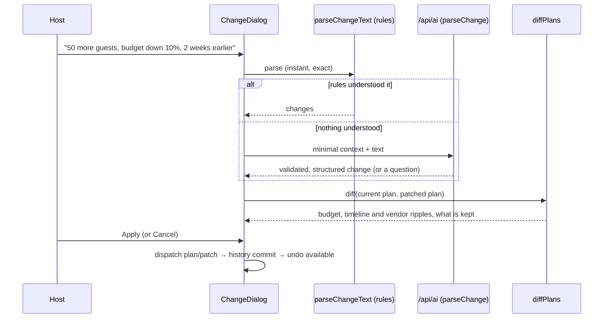

# Architecture

## Principles

1. **The AI suggests, the code decides.** Numbers, dates and ordering come from pure, tested functions.
   The model handles language and personalisation.
2. **A change is a patch, not a rebuild.** Every edit is a `ProfilePatch` (or a task, quote or idea
   action) applied by a reducer, so it can be previewed, applied, undone and restored.
3. **One source of truth for shapes.** zod schemas in `src/core/schemas.ts` and `src/core/contract.ts`
   define every persisted and transmitted shape. TypeScript types are inferred from them.
4. **The core is portable.** `src/core` has no React or DOM imports (lint-enforced) and type-checks as
   Node ESM, so the browser and the Vercel function share it.

## Modules

**Core** (`src/core`: pure TypeScript, shared by the browser and the server)

| Module                               | Responsibility                                                                                                               |
| ------------------------------------ | ---------------------------------------------------------------------------------------------------------------------------- |
| `budget.ts`                          | Category estimates (base rate × tier, custom rate or accepted quote), buffer, status, and warning rules                      |
| `timeline.ts`                        | Topological order, back-scheduling, proportional compression, delay propagation, Do next                                     |
| `tradeoffs.ts`                       | Levers (tier-down, skip, trim guests, reduce buffer), ranked by saving ÷ pain; greedy suggestion verified by exact recompute |
| `vendors.ts`                         | Requirement sheets, quote comparison and the vendor-question fallback                                                        |
| `validation.ts`                      | Guest, budget and quote checks with one message each, used by every form                                                     |
| `changes/parseChange.ts`             | Rule-based change parser (guests, budget, dates) with clarifying questions                                                   |
| `changes/text.ts`, `explicitDate.ts` | Number words → digits, clause splitting; absolute dates in Indian formats                                                    |
| `changes/resolveChanges.ts`          | Applies parsed changes to the current values and validates them                                                              |
| `changes/aiChange.ts`                | Conversion between parsed changes and the AI's flat output, in both directions                                               |
| `changes/diff.ts`                    | Before/after diff: field changes, line deltas, newly overdue tasks, compression, re-quote notices, what is kept              |
| `plan.ts`, `demo.ts`                 | Plan creation and the derived view model; the ready-made demo plans                                                          |
| `schemas.ts`, `contract.ts`          | zod schemas for every stored and transmitted shape; the API contract                                                         |
| `aiContext.ts`                       | The minimal, non-identifying context sent to the AI, including the budget band                                               |
| `constants/`                         | Rates, task templates, vendor checklists, enums and limits: data, not logic                                                  |

**Server** (`server`, `api`)

| Module                            | Responsibility                                                                                                   |
| --------------------------------- | ---------------------------------------------------------------------------------------------------------------- |
| `ai/handler.ts`                   | Guards (method → origin → type → size → JSON → schema → rate limit → injection), then cache, providers, fallback |
| `ai/tasks.ts`                     | The task registry: prompt, JSON schema, sanitizer and deterministic fallback per task, and `withTaskSpec`        |
| `ai/chain.ts`, `ai/breaker.ts`    | Ordered providers, per-provider timeouts, overall deadline, output validation; the circuit breaker               |
| `ai/providers/`                   | Gemini (SDK), and one OpenAI-compatible factory configured for OpenRouter and NVIDIA NIM                         |
| `config.ts`                       | Environment configuration with the free-tier model allowlist, limits, timeouts and cache size                    |
| `security/`, `cache.ts`, `log.ts` | Request guards, rate limiting, injection screen, output sanitizer; response cache; content-free JSON logs        |

**Browser** (`src`)

| Module                        | Responsibility                                                                                          |
| ----------------------------- | ------------------------------------------------------------------------------------------------------- |
| `state/store.ts`              | Reducer with commits, undo/redo (20 versions) and restore; `actions` creators that stamp the time       |
| `state/PlanContext.tsx`       | Loads and saves the store, derives the plan view model once per change                                  |
| `lib/apiClient.ts`            | POST /api/ai with timeout, de-duplication, caching, typed errors and re-validation                      |
| `lib/aiActions.ts`            | AI actions that fall back to the same core rules as the server                                          |
| `features/shared/useAiAction` | One way to run an AI action: pending state, notices, errors, and dropping answers made stale by an edit |
| `features/*`                  | One folder per screen; each screen is split into small components with named props                      |
| `components/`                 | Accessible primitives: fields (one shared shell), choice groups, dialog, tabs, notices, badges          |

## Request flow: "Something changed?"

## Deployment shape

- Static SPA built by Vite and served from Vercel's CDN with immutable hashed assets.
- `api/ai.ts` and `api/health.ts` are Vercel Functions on Node (Fluid compute, `maxDuration` 60 s), written
  as Web-standard `fetch` handlers. The server code uses explicit `.js` import specifiers and is
  type-checked with `module: NodeNext`, so it runs unbundled on Vercel.
- Warm instances share the module-level cache, rate limiter and circuit breaker.
