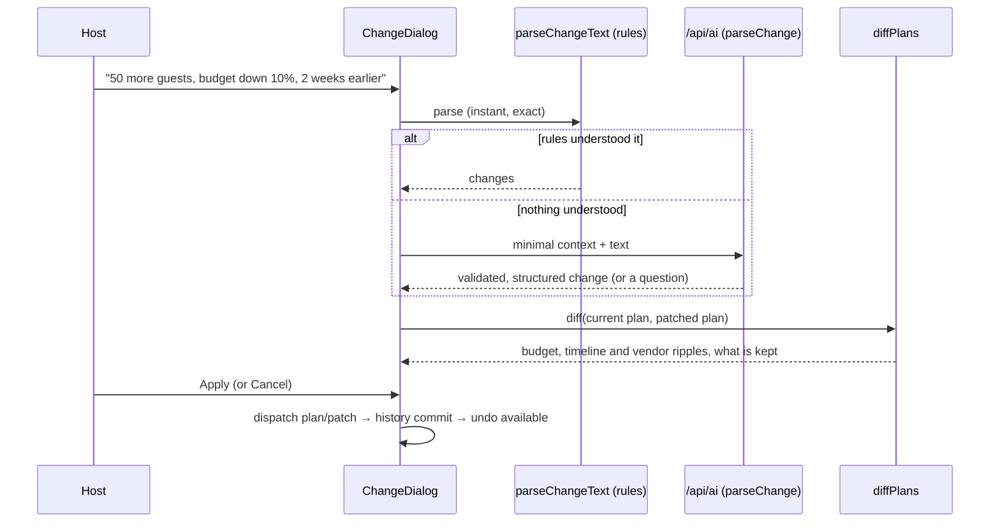

# Architecture

## Principles

1. **The AI suggests, the code decides.** Numbers, dates and ordering come from pure, tested functions.
   The model handles language and personalisation.
2. **A change is a patch, not a rebuild.** Every edit is a `ProfilePatch` (or a task, quote or idea
   action) applied by a reducer, so it can be previewed, applied, undone and restored.
3. **One source of truth for shapes.** zod schemas in `src/core/schemas.ts` and `src/core/contract.ts`
   define every persisted and transmitted shape. TypeScript types are inferred from them.
4. **The core is portable.** `src/core` has no React or DOM imports (lint-enforced) and type-checks as
   Node ESM, so the browser and the Vercel function share it.

## Modules

| Module                        | Responsibility                                                                                                               |
| ----------------------------- | ---------------------------------------------------------------------------------------------------------------------------- |
| `core/budget.ts`              | Category estimates (base rate × tier, or custom rate, or accepted quote), buffer, status, warnings                           |
| `core/timeline.ts`            | Topological order, back-scheduling, proportional compression, delay propagation, Do next                                     |
| `core/tradeoffs.ts`           | Levers (tier-down, skip, trim guests, reduce buffer), ranked by saving ÷ pain; greedy suggestion verified by exact recompute |
| `core/vendors.ts`             | Requirement sheets and quote comparison (coverage, vs estimate, missing inclusions)                                          |
| `core/changes/parseChange.ts` | Rule-based NL parser (lakh/crore/k, %, number words, relative and absolute dates) with clarifying questions                  |
| `core/changes/diff.ts`        | Before/after diff: field changes, line deltas, newly overdue tasks, compression, re-quote notices, what is kept              |
| `core/plan.ts`                | Plan creation, demo scenarios, derived view model                                                                            |
| `core/contract.ts`            | API request/response schemas, budget band                                                                                    |
| `server/ai/handler.ts`        | Request pipeline: method → origin → type → size → JSON → schema → rate limit → injection → cache → providers → fallback      |
| `server/ai/chain.ts`          | Ordered providers, timeouts, deadline, circuit breaker, output validation                                                    |
| `server/ai/tasks.ts`          | Per-task prompt, JSON schema, sanitiser and deterministic fallback                                                           |
| `state/store.ts`              | Reducer with commits, undo/redo (20 versions) and restore                                                                    |
| `lib/aiActions.ts`            | Browser-side AI actions that degrade to the same rules as the server                                                         |

## Request flow: "Something changed?"

## Deployment shape

- Static SPA built by Vite and served from Vercel's CDN with immutable hashed assets.
- `api/ai.ts` and `api/health.ts` are Vercel Functions on Node (Fluid compute, `maxDuration` 60 s), written
  as Web-standard `fetch` handlers. The server code uses explicit `.js` import specifiers and is
  type-checked with `module: NodeNext`, so it runs unbundled on Vercel.
- Warm instances share the module-level cache, rate limiter and circuit breaker.
